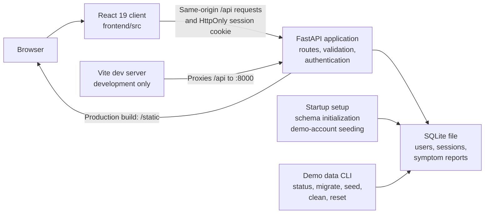

# Healthwatch application architecture

## Current system

Healthwatch is a small, single-service symptom-reporting application. The React
client calls a FastAPI API; the API enforces login and role access, validates
requests, and reads or writes a local SQLite database. In production-build
mode, FastAPI serves the built client and API from the same origin.

## Component responsibilities

| Component | Responsibilities |
|---|---|
| React client (`frontend/src/main.jsx`, `styles.css`) | Login, role-specific screens, patient symptom submission/history, clinician report filtering and review actions. Uses JSON API responses; it does not connect directly to SQLite. |
| Vite (`vite.config.js`) | Local frontend development and `/api` proxy to `http://127.0.0.1:8000`; produces the static client build under `src/public/`. |
| FastAPI app (`src/server/main.py`) | Registers API and auth routes, error handlers, request logging, serves `/static`, and initializes the database and demo accounts at startup. |
| Routes and schemas (`src/routes/`, `src/middleware/schemas.py`) | Validate request data, apply patient/doctor authorization dependencies, and coordinate symptom report and review operations. |
| Authentication (`src/routes/auth.py`) | Verifies Argon2 password hashes, creates opaque random sessions, stores only a SHA-256 token hash, and sends the session token in an HttpOnly cookie. |
| SQLite data layer (`src/routes/database.py`) | Creates/upgrades the current schema and performs parameterized queries for accounts, sessions, report history, summaries, and reviews. |
| Demo-data CLI (`src/manage_demo_data.py`) | Inspects counts and explicitly migrates, seeds demo users, removes expired sessions, or resets reports and sessions. |

## Data model and request flow

The current SQLite schema has three tables:

- `users`: unique normalized email, Argon2 password hash, role (`patient` or
  `doctor`), and optional patient ID.
- `user_sessions`: hashed session token, user ID, and expiration timestamp.
- `symptom_reports`: patient ID, submission time, JSON symptom list, patient
  notes, review status, and clinician review notes.

There is one configured demo patient ID. Patient and doctor accounts are
created if missing during application startup. The profile endpoint returns
the signed-in account email and patient ID; fabricated demographics and a
care-team directory are not part of the current data model. Reports submitted
by the patient are persisted in SQLite and appear in the patient history and
the clinician dashboard. Clinicians can save review status and notes through
the protected review endpoint; patient responses omit clinician-only notes.

`src/routes/database.py:init_db()` creates missing tables and adds supported
report columns to older databases. This is lightweight, idempotent schema
initialization, not a versioned Alembic migration history. Review
[deployment and testing](./04-delivery-plan.md#testing-deployment-and-release-plan) before upgrading or
deploying a database.

## Authentication and authorization

Login credentials are checked against user records. Passwords are stored as
Argon2 hashes. Successful login creates a random session token; the browser
receives it as an HttpOnly, SameSite=Lax cookie, and SQLite stores only its
SHA-256 hash and expiration. Patient routes require a patient role and access
to the configured demo patient. Clinician routes require a doctor role.

The `HEALTHWATCH_COOKIE_SECURE` setting defaults to `false` for local HTTP
development and is `true` in the Render Blueprint, where HTTPS is used. Fixed
demo accounts are seeded at startup. These are demo-only choices and are not
safe defaults for real patient data; see the deployment readiness notes in
[04-delivery-plan.md](./04-delivery-plan.md#testing-deployment-and-release-plan).

## Runtime and deployment shape

- **Development:** Vite runs the React client, FastAPI runs on port 8000, and
  Vite proxies `/api` requests to FastAPI.
- **Built local demo:** `npm run build` writes the frontend into `src/public/`;
  FastAPI serves the UI and API on the same origin.
- **Render demo:** `render.yaml` builds the frontend and Python service into a
  Docker image. FastAPI serves the UI and API over HTTPS, and Render mounts a
  persistent disk at `/var/data` for SQLite.
- **Database:** SQLite is a local file, defaulting to `src/data/healthwatch.db`;
  `HEALTHWATCH_DB_PATH` can select another path. The file's parent directory
  must exist and be writable; Render uses `/var/data/healthwatch.db`.
- **CI and deployment:** GitHub Actions runs backend tests plus frontend lint
  and build on pushes and pull requests to `main`. Render auto-deploys `main`
  only after those checks pass.
- **External integrations:** No EHR, OpenFDA, managed database, or
  notification provider is wired into this application. Render provides
  hosting only.

SQLite keeps local setup simple but is intended here for a single-instance
demo, not high-concurrency or multi-instance production operation. This
application is a synthetic-data course demo and is not certified or suitable
for real patient information or clinical use.
