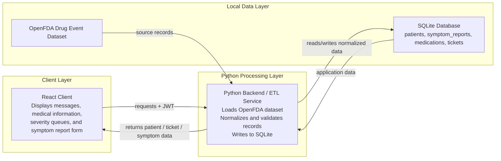

# 2. Architecture

## Component boundaries

Component Descriptions

| Component | Owns | Does Not Own |
|---|---|---|
| React Client | displays messages, medical information, and severity queues; symptom report form access; manages auth tokens | database access; authentication logic |
| Python Backend / ETL | loads and normalizes the OpenFDA dataset; validates symptom severity matching; writes to SQLite; verifies incoming JWT tokens | user interface behavior; decision-making on behavior without data |
| SQLite + OpenFDA Drug Event Data Set | provides past information of patients, drug use, their physicians, and logged side effects; stores normalized patient, medication, symptom, and ticket records | user interface rendering; token generation |

## Data Entities & Relationships
- patients: id, name, gender, birthdate, role
- patient_medications: id, patient_id, medication_id, start_date, end_date
- symptom_report: id, owner_id, timestamp
- symptom_report_symptoms: id, symptom_id, severity
- symptom_report_medications: id, medication_id
- medications: id, name, manufacturer
- symptoms: id, term
- ticket: id, time_stamp, patient_id, symptom_report_ids, severity, status

Each patient owns multiple symptom logs and medications. Each symptom log references one or more medications and symptoms. Each ticket owns one symptom report. The patient medications end_date attribute tracks medication discontinuation or change.

## Authentication, Authorization, Secrets, & Persistent Data
Authentication relies on lightweight JSON Web Tokens (JWT) generated after validating pre-seeded synthetic credentials for patients and doctors. Authorization is strictly enforced using role-based access control (RBAC) at the backend layer. The Auth Service validates all credentials against pre-seeded user records and issues JWTs for authenticated sessions. The React Client stores tokens in secure, httpOnly cookies and includes them in all API requests. The Python Backend verifies token validity before processing requests, ensuring only authenticated and authorized users can access patient records and create tickets.

## Decisions & Tradeoffs
SQLite was chosen to ensure zero-configuration deployment and quick local setup, accepting the tradeoff that write concurrency is limited under heavy loads. The team opted to pre-load a normalized subset of the OpenFDA dataset to avoid external API dependencies during development. JWT authentication was selected for its stateless nature, making it ideal for a lightweight local deployment without requiring a separate session store.

