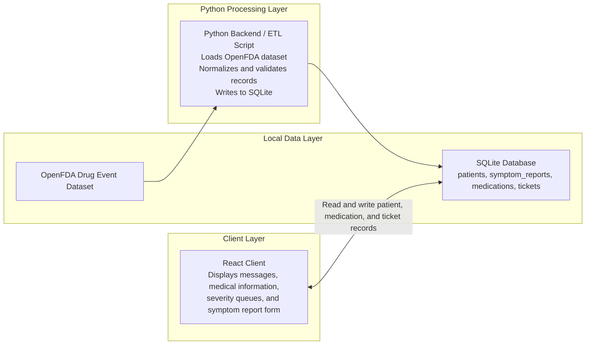

# 2. Architecture

## Component boundaries

Component Descriptions

Component | Owns | Does Not Own|
|---|---|---|
|React Client| displays messages, medical information, and severity queues; symptom report form access| database access|
|Python Backend / ETL| loads and normalizes the OpenFDA dataset; validates symptom severity matching; writes to SQLite| user interface behavior; decision-making on behalf of doctors|
|SQLite + OpenFDA Drug Event Data Set| provides past information of patients, drug use, their physicians, and logged side effects; stores normalized patient, medication, symptom, and ticket records| direct application logic|

## Data Entities & Relationships
- patients: id, name, gender, birthdate
- symptom_report: id, owner_id, timestamp,
- symptom_report_symptoms: id, symptom_id, severity
- symptom_report_medications: id, medication_id
- medications: id, name, manufacturer
- patient_medications: id, patient_id, medication_id, date, status
- ticket: id, time_stamp, patient_id, symptom_report_ids, severity, status
- symptoms: id, term

Each patient owns multiple symptom logs, and medications. Each symptom log references one or more medications and symptoms. Each ticket owns one symptom reports.

## Authentication, Authorization, Secrets, & Persistent Data
Authentication relies on lightweight JSON Web Tokens (JWT) generated after validating pre-seeded synthetic credentials for patients and doctors. Authorization is strictly enforced using role-based access controls before data is returned to the client. Sensitive credentials are kept in local configuration/secrets files rather than embedded in the frontend. Persistent data is stored in SQLite and seeded from the OpenFDA dataset; the patient, symptom, medication, and ticket tables provide local state across app sessions.

## Decisions & Tradeoffs
SQLite was chosen to ensure zero-configuration deployment and quick local setup, accepting the tradeoff that write concurrency is limited under heavy loads. The team opted to pre-load a normalized subset of the OpenFDA dataset into SQLite so the application can access historical patient and adverse event information without requiring a separate API server. The Python backend runs as a data-loading script at initialization rather than as a persistent service.

## Technical Risks and Unknowns
The primary technical risk involves unstandardized or inconsistent symptom terms within the OpenFDA adverse drug event dataset, which will be mitigated by a technical spike dedicated to cleaning and normalizing symptom names before they are stored in SQLite.
